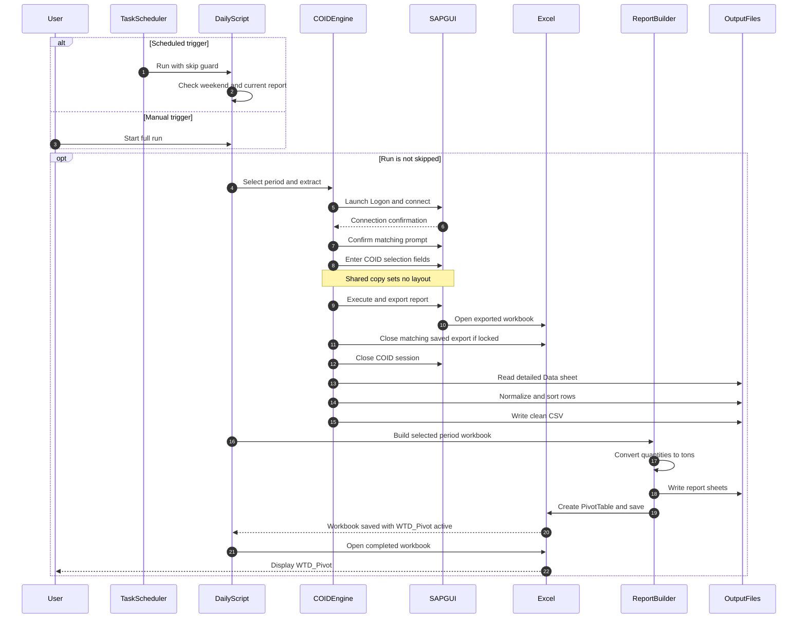
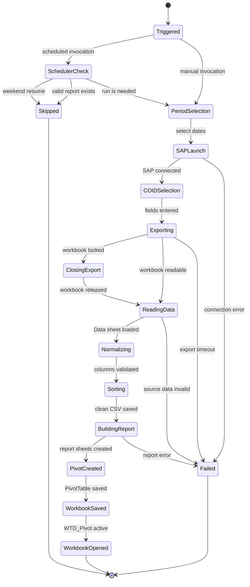
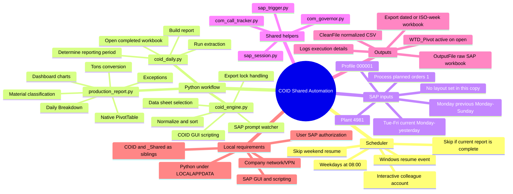

# COID Shared Automation Diagrams

**By Jompe Emmanuel Ayomiposi, +234 807 145 5374**

I use these diagrams to explain how the layout-free `COID_Shared` copy runs.

## Sequence

## Workflow State

## Mind Map

